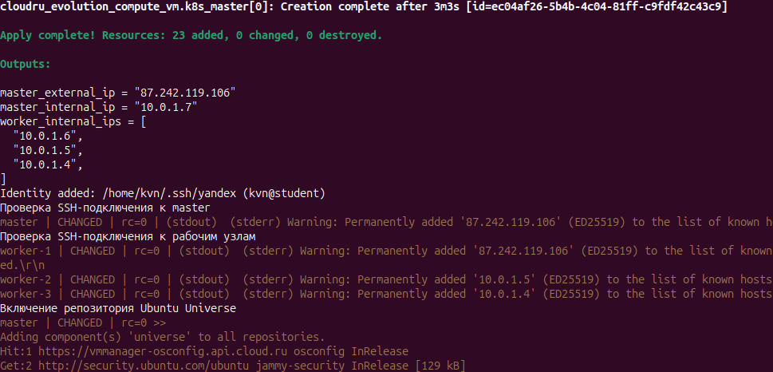
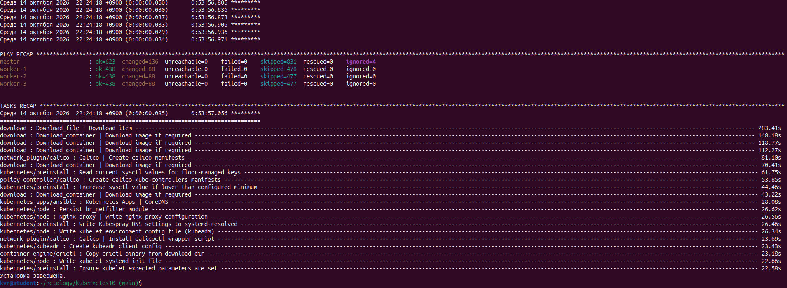
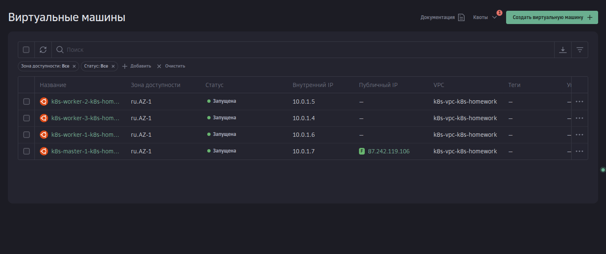
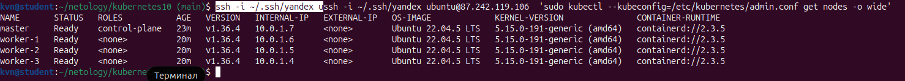
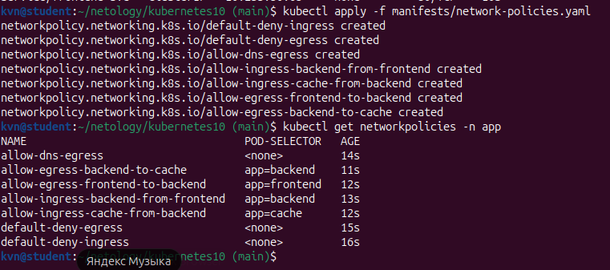
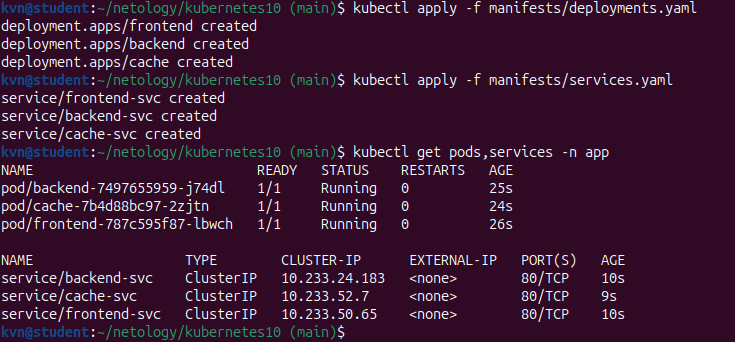

# Сетевые политики в Kubernetes

## Развёртывание кластера

Для Cloud.ru запустите:

```bash
./deploy.sh cloudru
```

Для Yandex Cloud:

```bash
./deploy.sh yandex
```

Перед запуском скопируйте `terraform/terraform.tfvars.example` в `terraform/terraform.tfvars` и заполните параметры выбранного облака. Файл `terraform/terraform.tfvars` содержит учётные данные и не должен попадать в Git. Путь к приватному SSH-ключу задаётся через `SSH_PRIVATE_KEY_PATH`; если переменная не задана, используется `~/.ssh/yandex`.

`deploy.sh` создаёт инфраструктуру Terraform, формирует inventory по шаблону `terraform/inventory.yaml.tpl` и запускает Kubespray `v2.32.0` для установки Kubernetes с Calico. Перед установкой скрипт проверяет SSH-доступ к узлам и обновляет списки пакетов Ubuntu. Установка пакетов и загрузка образов могут занять время.

Для Cloud.ru и Yandex Cloud используются отдельные Terraform workspaces `cloudru` и `yandex`. Локальные состояния хранятся в `terraform/terraform.tfstate.d/` и не добавляются в Git. Для удаления инфраструктуры запустите `./destroy.sh cloudru` или `./destroy.sh yandex`.

## Задание 1. Приложения

Создание кластера

  
  
  

Создаём namespace `app` и запускаем приложения и сервисы:

```bash
kubectl create namespace app
kubectl apply -f manifests/deployments.yaml
kubectl apply -f manifests/services.yaml
kubectl get pods,services -n app
```

В namespace запускаются `frontend`, `backend` и `cache`.



## Задание 1. Сетевые политики

Применяем политики, которые разрешают DNS, соединения от frontend к backend и от backend к cache. Остальные соединения в namespace блокируются.

```bash
kubectl apply -f manifests/network-policies.yaml
kubectl get networkpolicies -n app
```



## Задание 1. Проверка сетевого доступа

Запускаем проверку разрешённых и запрещённых соединений:

```bash
./scripts/test_network.sh
```



## Файлы проекта

- `terraform/` — создание виртуальных машин и inventory.
- `deploy.sh` — запуск Terraform и Kubespray для выбранного облака.
- `manifests/` — приложения, сервисы и сетевые политики.
- `scripts/test_network.sh` — проверка сетевого доступа.

Параметры облака и учётные данные задаём в локальном `terraform/terraform.tfvars`. Пример параметров находится в `terraform/terraform.tfvars.example`.
