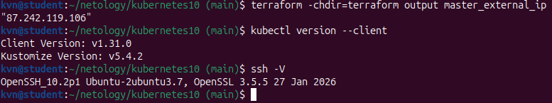
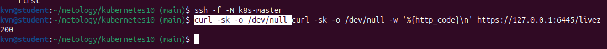
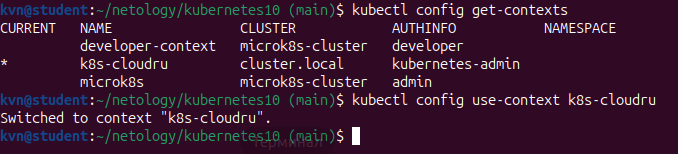
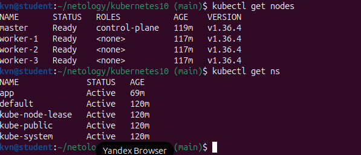
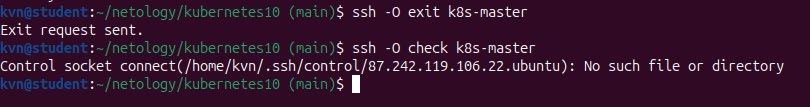
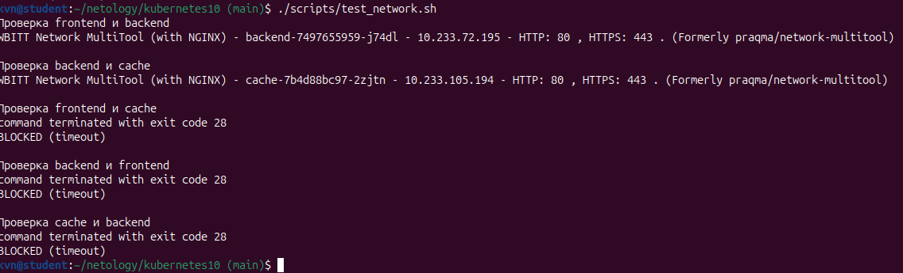

# Сетевые политики в Kubernetes

## Развёртывание кластера

Для Cloud.ru запустите:

```bash
./deploy.sh cloudru
```

Для Yandex Cloud:

```bash
./deploy.sh yandex
```


`deploy.sh` создаёт инфраструктуру Terraform, формирует inventory по шаблону `terraform/inventory.yaml.tpl` и запускает Kubespray `v2.32.0` для установки Kubernetes с Calico. Перед установкой скрипт проверяет SSH-доступ к узлам и обновляет списки пакетов Ubuntu.  

Для Cloud.ru и Yandex Cloud используются отдельные Terraform workspaces `cloudru` и `yandex`. Локальные состояния хранятся в `terraform/terraform.tfstate.d/` и не добавляются в Git. Для удаления инфраструктуры запустите `./destroy.sh cloudru` или `./destroy.sh yandex`.

## Задание 1. Приложения

Создание кластера в Cloud.ru при помощи kubespray:


Подключимся к master ноде и проверим что кластер развернулся:


Создаём namespace `app`:

```bash
kubectl create namespace app
```

Разворачиваем приложения frontend, backend, cache:

```bash
kubectl apply -f manifests/deployments.yaml
kubectl apply -f manifests/services.yaml
kubectl get pods,services -n app
```

В namespace запускаются `frontend`, `backend` и `cache`.


## Управление кластером с локальной машины

Security group Cloud.ru открывает наружу только SSH (TCP/22), а порт API-сервера 6443 доступен только внутри подсети `10.0.1.0/24`. Поэтому локальный `kubectl` работает через SSH-туннель к master-ноде (bastion host). Туннель организуем штатными средствами OpenSSH — записью `LocalForward` в `~/.ssh/config`.

### Шаг 0. Предварительные условия

Перед настройкой подключения проверяем, что кластер уже развёрнут (`./deploy.sh cloudru` или `./deploy.sh yandex`), а локальные инструменты установлены. Заодно сохраняем внешний IP master-ноды — он понадобится на шаге 1.

```bash
terraform -chdir=terraform output master_external_ip
kubectl version --client                               # локальный клиент kubectl
ssh -V                                                 # OpenSSH
```



### Шаг 1. Настройка `~/.ssh/config`

Добавляем в `~/.ssh/config` блок на master-ноду. `LocalForward 6445 127.0.0.1:6443` слушает локальный порт 6445 и перенаправляет трафик через SSH на порт 6443 API-сервера:

```ssh_config
Host k8s-master
    HostName              87.242.119.106
    User                  ubuntu
    IdentityFile          ~/.ssh/yandex
    IdentitiesOnly        yes
    LocalForward          6445 127.0.0.1:6443
    ExitOnForwardFailure  yes
    ServerAliveInterval   30
    ServerAliveCountMax   3
```

Опции:

- `LocalForward 6445 127.0.0.1:6443` — туннель: локальный порт `6445` → `127.0.0.1:6443` на master;
- `ExitOnForwardFailure yes` — не создавать сессию, если локальный порт не открылся;
- `ServerAliveInterval` / `ServerAliveCountMax` — keepalive, чтобы туннель не разрывался.

### Шаг 2. Запуск туннеля

```bash
ssh -f -N k8s-master   # только проброс порта
curl -sk -o /dev/null -w '%{http_code}\n' https://127.0.0.1:6445/livez
```



### Шаг 3. Локальный kubeconfig

Локальный kubeconfig собран из `/etc/kubernetes/admin.conf` мастера (его создаёт Kubespray при установке): поле `server` переписано на `https://127.0.0.1:6445`, контекст переименован в `k8s-cloudru`:

```bash
kubectl config get-contexts
kubectl config use-context k8s-cloudru
```



### Шаг 4. Проверка

```bash
kubectl get nodes
kubectl get ns
```



### Шаг 5. Остановка туннеля

```bash
ssh -O exit k8s-master    # остановить туннель
ssh -O check k8s-master   # проверка состояния мастер-соединения
```

После остановки управляющий сокет удаляется, поэтому `ssh -O check k8s-master` возвращает `Control socket connect(...): No such file or directory`, а локальный порт 6445 перестаёт слушаться — значит, туннель закрыт.



## Задание 2. Сетевые политики

Применяем политики, которые разрешают DNS, соединения от frontend к backend и от backend к cache. Остальные соединения в namespace блокируются.

Манифест `manifests/network-policies.yaml` генерируется Terraform из шаблона `terraform/network-policies.yaml.tpl`. Это нужно, потому что DNS-адрес node-local-dns (link-local `169.254.25.10`) не должен хардкодиться в манифесте: он передаётся через переменную Terraform `nodelocaldns_ip` (задаётся в `terraform.tfvars` или берётся из значения по умолчанию). При `terraform apply` манифест пересоздаётся автоматически:

```bash
kubectl apply -f manifests/network-policies.yaml
kubectl get networkpolicies -n app
```


## Задание 3. Проверка сетевого доступа

Запускаем проверку разрешённых и запрещённых соединений:

```bash
./scripts/test_network.sh
```



## Файлы проекта

| Файл | Назначение |
|---|---|
| [manifests/deployments.yaml](manifests/deployments.yaml) | Deployment frontend, backend, cache |
| [manifests/services.yaml](manifests/services.yaml) | ClusterIP-сервисы |
| [manifests/network-policies.yaml](manifests/network-policies.yaml) |  Политики изоляции (генерируется Terraform из terraform/network-policies.yaml.tpl) |
| [terraform/network-policies.yaml.tpl](terraform/network-policies.yaml.tpl) | Шаблон сетевых политик с переменной nodelocaldns_ip |
| [scripts/test_network.sh](scripts/test_network.sh) | Проверка соединений |
